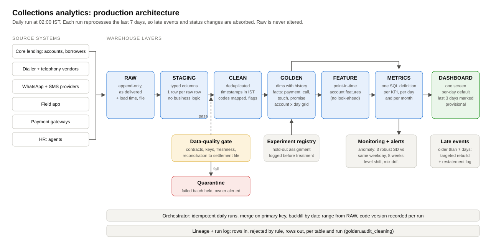
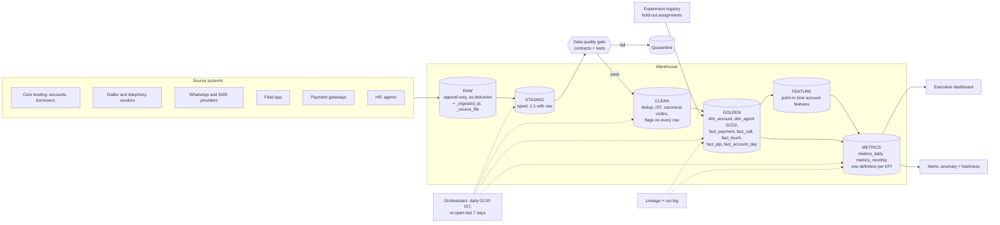

# Production analytics design (Part 5)

How this analysis becomes a system leadership reads every morning. The SQL in `sql/` is already organised in these layers; what follows is what an engineering team adds around it.

## Architecture diagram

The same flow as a Mermaid diagram (renders on GitHub):

## Layers

| Layer | Contents | Rule | Who may read it |
|---|---|---|---|
| Raw | Files and API payloads exactly as received, plus `_ingested_at`, `_source_file`, `_row_hash` | Append-only. Never updated, never deleted. | Data engineering |
| Staging | Typed columns, one row per raw row | Row count equals raw. No business logic. | Data engineering |
| Clean | One table per source: deduplicated, IST timestamps, canonical codes, quality flags | Deterministic. Every dropped row is countable. | Analysts |
| Golden | Conformed dimensions and facts at a stated grain | Primary keys enforced. Only layer dashboards may join. | Everyone |
| Feature | Per-account features as of a date (DPD, balance, touches in the last 7 and 30 days, days since last payment) | Point-in-time correct: a feature dated D uses nothing after D. | Models, experiments |
| Metrics | One row per day, month and dimension | Each KPI is defined once, in SQL, with an owner. | Dashboard |

## Primary keys and grain

| Table | Grain | Primary key | Notes |
|---|---|---|---|
| `fact_payment` | one payment event | `payment_id` | `payment_reference` is not unique and must not be used as a key |
| `fact_call` | one call | `call_id` | earliest `event_at` wins when copies disagree |
| `fact_touch` | one borrower touch on any channel | `touch_id` + `channel` | |
| `fact_ptp` | one promise | `ptp_id` | |
| `fact_account_day` (production) / `fact_account_month` (this repo) | account × period | `account_id` + date | every account in every period |
| `dim_account` | account, slowly changing | `account_id` + `valid_from` | DPD and balance history must be kept; today there is one snapshot |
| `dim_agent` | agent, slowly changing | `agent_key` + `valid_from` | `agent_key` issued by HR, mapped from `agent_id` and `employee_code` |
| `dim_campaign` | campaign version | `campaign_id` + `strategy_version` + `valid_from` | target definition is immutable per version |

## Data contracts

Each source owner signs a contract; the pipeline tests it on every load and quarantines a batch that breaks it.

| Source | Contract |
|---|---|
| Payments | `payment_id` unique and not null. `amount` > 0. `payment_status` in a fixed list. `event_at` in UTC with offset. `account_id` exists in accounts. A reversal references the original `payment_id`. |
| Calls | `call_id` unique. `event_at` in UTC with offset (the `timezone` column goes away). `vendor_id` and `agent_id` not null. `call_status` in a fixed list. `call_type` added: human, predictive, IVR, agentic. |
| Dispositions | Code from a versioned reference table with effective dates; an unknown code fails the batch. Disposition allowed only on a call that exists. |
| Agents | One row per agent per validity period. `employee_code` unique at any point in time. |
| Targeting | `strategy_version` and `experiment_arm` on every row. `target_date` inside the campaign's dates. |
| All | Schema changes are announced with a version bump; breaking changes need a migration date. |

## Metric definitions

| Metric | Definition | Denominator |
|---|---|---|
| Recovery | Sum of `amount` for unique payments with status `SUCCESS`, net of later reversals | n/a |
| Recovery per day | Recovery ÷ calendar days in the period | days |
| Recovery rate (30-day) | Recovery per day × 30 ÷ outstanding balance at the start of the period | whole book |
| Payer rate | Accounts with at least one recovery payment ÷ accounts in the book | whole book |
| Contact rate | Accounts with at least one answered call ÷ accounts dialled | accounts |
| RPC rate | Accounts with an answered call whose final disposition is right-party ÷ accounts dialled | accounts |
| PTP rate | Accounts with a promise ÷ accounts effectively contacted | accounts |
| PTP kept rate | Matured promises with successful payments ≥ 90% of the promised amount between promise date and due date + 3 days ÷ matured promises | promises |
| Recovery per agent-hour | Recovery ÷ logged-in agent hours in IST. Shown as a ratio, not as productivity | hours |
| Cost per rupee recovered | (agent hours × rate + touches × unit cost) ÷ recovery. Needs finance to supply unit costs | rupees |
| Channel lift | 7-day payment rate after an effective contact − 7-day payment rate of the randomised hold-out | contacts |

Every month-level metric is also published per calendar day, and the dashboard's default comparison is per day.

## Lineage

Each golden and metrics row carries `_run_id`, `_built_at` and `_source_max_ingested_at`. A run log records, per table and run: input rows, rejected rows by rule, output rows. This is `golden.audit_cleaning` in the repo, kept per run in production. Column-level lineage comes from the transformation tool (dbt or equivalent), so "where does recovery come from" is answerable from the dashboard tile down to the raw file.

## Incremental processing, late data and backfills

| Topic | Design |
|---|---|
| Incremental load | Daily at 02:00 IST. Each run reprocesses a rolling 7-day window by event date, merging on the primary key, so re-running a day gives the same result. |
| Late-arriving data | Events are partitioned by event date and tracked by ingestion time. Anything arriving for a day inside the window is picked up by the next run. Arrivals older than 7 days go to a late-events table and trigger a targeted rebuild of the affected partitions. |
| Restatement | The dashboard shows the last 3 days as provisional. A metric that changes by more than 1% after it has been published raises an alert and is logged with the before and after values. |
| Reversals and pending payments | A payment's status can change. The fact is rebuilt from the latest status per `payment_id`; a status-history table keeps every change. |
| Backfill | One command with a date range rebuilds clean, golden and metrics for those partitions from raw. Raw is never altered. Logic changes are versioned; a backfill records the code version it ran with. |
| Overwritten history | Dimensions become slowly-changing type 2 (`valid_from`, `valid_to`). Daily snapshots of accounts start now, because DPD and balance history cannot be recovered. |

## Data-quality checks

Run after every load. A blocking check stops publication; a warning check publishes and alerts.

| Check | Type | Threshold |
|---|---|---|
| Primary key unique and not null | Blocking | 0 violations |
| Staging rows = raw rows | Blocking | exact |
| Foreign keys resolve (payment → account, call → agent, call → vendor) | Blocking over 0.5% | Warning under |
| Duplicate rate per table | Warning | more than 2× the 30-day average |
| Unknown disposition, status or channel code | Blocking | 0 |
| Timestamps carry an offset and are not in the future | Blocking | 0 |
| Share of right-party dispositions on unanswered calls | Warning | above 1% |
| Share of promises marked kept with no payment | Warning | above 10% |
| Calls outside permitted hours in IST | Warning to compliance | any |
| Freshness: latest event per source | Blocking | older than 26 hours |
| Reconciliation: recovery against the bank or gateway settlement file | Blocking | differs by more than 0.5% |

## Monitoring and anomaly detection

- **Pipeline health:** run duration, rows in and out per layer, rejected rows by rule, freshness per source. Alerts go to the on-call engineer.
- **Metric anomalies:** each daily metric is compared with a forecast from the same weekday over the previous 8 weeks. A value more than 3 robust standard deviations away is flagged on the dashboard and sent to the metric owner. Daily recovery in this data varies about 14% day to day, so single days are noisy; the alert also runs on the 7-day rolling mean.
- **Level shifts:** a weekly CUSUM test on recovery per day, the same test used in the notebook, reports the most likely break date and whether it is significant.
- **Mix drift:** weekly comparison of the worked population (DPD bucket, risk segment, loan type) with the previous 4 weeks. A shift above 2 percentage points is annotated on the dashboard, so a change in mix is never read as a change in performance.
- **Definition drift:** metric SQL is version-controlled; a change to a definition needs review and writes a marker onto the time series.
- **Experiments:** hold-out assignment is logged before treatment. The dashboard reports lift against the hold-out with a confidence interval, never a before-and-after comparison.
